# VisionForge Studio

[](LICENSE)
[](https://www.python.org/)
[](https://fastapi.tiangolo.com/)
[](https://react.dev/)
[](https://www.typescriptlang.org/)
[](https://pytorch.org/)
[](https://ultralytics.com)
[](https://huggingface.co/microsoft/Florence-2-base)
[](https://github.com/facebookresearch/sam2)
[](https://onnxruntime.ai/)
[-9900ff.svg)](https://www.kaggle.com)
[](https://github.com/Sanchit711/Visionforge)
[](https://github.com/Sanchit711/Visionforge)

> **The One-Stop AI/ML Development Studio for Computer Vision**  
> *Frictionless Data-to-Model Engineering: Smart Selective Frame Extraction, AI-Assisted Annotation, 1-Click Cloud Training & Visual Multi-Model Comparison.*

VisionForge Studio replaces the fragmented chaos of modern computer vision development. Instead of roaming across 10 disconnected tools—juggling ffmpeg terminal commands, OpenCV blur scripts, Roboflow/CVAT, Kaggle/Colab notebooks, TensorBoard tabs, and custom evaluation scripts—VisionForge unites the entire ML development lifecycle into a single, cohesive, Apple-inspired workbench.

---

### 🌐 Core Developer Capabilities
[](https://github.com/topics/computer-vision)
[](https://github.com/topics/pose-estimation)
[](https://github.com/topics/video-annotation)
[](https://github.com/topics/florence-2)
[](https://github.com/topics/yolo)
[](https://github.com/topics/kaggle)
[](https://github.com/topics/object-detection)
[](https://github.com/topics/edge-ai)
[-FF4500?style=flat-square&logo=webrtc&logoColor=white)](https://github.com/topics/computer-vision)
[](https://github.com/topics/computer-vision)

---

### 💡 Why VisionForge? The "One-Stop" Developer Experience
* **Multi-Task AI Suite**: Unified annotation and YOLO training pipeline supporting standard Bounding Boxes (`B`), 5-parameter Oriented Bounding Boxes (`O` with angular heading ray), 17-point Humanoid Pose rigs (`K` with COCO skeletal bones), and sub-pixel polygon masks (`P`).
* **Biomechanical Kinematics & REBA Ergonomics**: Real-time joint angle protractor trigonometry computing Knee Flexion ($\theta_{\text{knee}}$) and Torso Lean ($\theta_{\text{spine}}$) with automated REBA/RULA posture risk classification (`SAFE_SQUAT`, `SPINAL_STRAIN`, `OVERHEAD_WORK`).
* **20-Minute Continuous Validation Engine**: Large-scale 1,200-second (18,000 continuous frames @ 15 FPS) validation video synthesizer with running timecode (`00:00:00.00` to `00:20:00.00`), monotonic frame indexing, live HUD telemetry, and broadcast H.264 (`yuv420p`, `+faststart`) encoding for zero-buffering native web/IDE streaming.
* **Selective Frame Extraction**: Ingest raw video, set an ROI crop, and let automated Laplacian sharpness filters and perceptual hash deduplication curate only the sharp, non-redundant frames (saves up to 90% of storage and labeling time).
* **AI-Assisted Annotation**: Zero-shot prompt grounding with **Microsoft Florence-2**, pixel-exact boundary masks with **Meta SAM 2**, and **rigid-body keyframe trajectory interpolation** that tracks objects across frames with physical dimensions locked.
* **Leak-Proof Dataset Engineering**: Enforce contiguous chronological/temporal chunk splitting (`split_strategy="temporal"`), preventing consecutive video frames from bleeding between Train and Val sets. Automatically exports YOLO formats with `kpt_shape: [17, 3]` and `flip_idx`.
* **1-Click Headless Cloud Training**: Push training runs directly to remote cloud GPUs (Kaggle Dual Tesla T4s) with live streaming loss curves, learning rate dynamics, and validation mAP50 telemetry—without touching notebooks.
* **Edge Model Export Engine**: 1-Click hardware compilation to **ONNX Universal** (with OnnxSlim), **Intel OpenVINO** (`.xml`/`.bin`), **NVIDIA TensorRT** (`.engine`), **Apple Silicon CoreML** (`.mlpackage`), and **TensorFlow Lite** (`.tflite`).
* **In-Browser Live Webcam / Video Tester**: Run real-time edge inference directly inside your browser on live video feeds with live sub-30ms latency HUD, FPS counter, and 1-click snapshot downloads.
* **Side-by-Side Model Comparison**: Compare multiple trained checkpoints simultaneously on synchronized video playback, measuring real latency (ms), throughput (FPS), and sub-pixel stability.
* **Enterprise 14-Station Interactive Tour**: Pinpoint visual spotlighting with SVG cutout masks, step-by-step operational lifecycle flows, and immediate live-test triggers for seamless operator onboarding.

---

## 🗺️ Next-Gen Multi-Model Capabilities Roadmap

VisionForge is expanding beyond standard 2D axis-aligned bounding boxes into a full-spectrum industrial computer vision engine.

> 📘 **Full Technical Specification & Roadmap**:  
> Read the complete architectural document: [**`docs/ROADMAP_SEGMENTATION_POSE_MULTIMODEL.md`**](docs/ROADMAP_SEGMENTATION_POSE_MULTIMODEL.md)

### Multi-Task Architectural Overview
| Model Capability | Supported Architectures | Annotation Canvas Tools | Industrial Factory Use Case |
| :--- | :--- | :--- | :--- |
| **Instance & Semantic Segmentation** | YOLOv8-seg, YOLO11-seg, Meta SAM 2.1, FastSAM | Sub-pixel Polygon Tool (`P`), Bezier curve smoothing, magnetic edge snapping | Surface defect area sizing ($\text{mm}^2$), irregular packaging tears, liquid spill boundaries |
| **Kinematic Pose Estimation** | YOLOv8-pose, YOLO11-pose, RTMPose | Skeletal Topology Configurator, Joint visibility flags (`v=0,1,2`), Bone graph links | Robotic pick-and-place gripper alignment, operator ergonomic lifting posture & hazard intrusion |
| **Oriented Bounding Boxes (OBB)** | YOLOv8-obb, YOLO11-obb | Rotated Box Tool (`O`), center-angle handle ($\theta \in [-\pi/2, \pi/2]$), 4-vertex projection | Skewed parcels on high-speed conveyors; eliminates overlapping box NMS dropouts |
| **Monocular 3D Volumetrics** | Depth Anything v2 (Small/Base) | Automated Conveyor Ground Plane Calibration ($Ax + By + Cz + D = 0$) | Metric parcel dimensioning ($L \times W \times H$) and cubic volume ($\text{cm}^3$) without LiDAR |
| **NMS-Free Real-Time Transformers** | RT-DETR-L, RT-DETR-X | Transformer Query Visualization | Ultra-dense conveyor item detection with zero heuristic NMS tuning |

---

## Key Highlights & Architectural Capabilities

### 1. Headless Cloud Acceleration (Kaggle Dual Tesla T4 GPUs)
- **Zero-Setup Dispatch in 3 Clicks**: Select your frozen YOLO dataset snapshot, choose hyperparameter presets, and launch automated PyTorch DDP training directly on Kaggle's dual NVIDIA Tesla T4 GPUs (32 GB VRAM).
- **Automated Cloud Staging**: Compresses frames, builds valid Ultralytics `data.yaml`, creates private Kaggle datasets, generates training kernels, and executes cloud training completely headlessly via the Kaggle API.
- **Live Glassmorphic Telemetry HUD**: Real-time telemetry streaming (`GET /api/v1/kaggle/telemetry`), live epoch progression, loss curves (`box_loss`, `cls_loss`, `l1_loss`), validation precision, recall, mAP@50, and mAP@50-95.
- **Automated Model Ingestion**: Downloads converged `best.pt` weights, computes SHA-256 integrity checksums, and imports directly into the VisionForge Model Registry with full metric lineage.

### 2. In-Motion Forensic Benchmarking & Quad-Split Video Comparison
- **Temporal Stress Testing on Conveyor Feeds**:
  - **Ingress Detection Latency**: Frame-accurate measurement of when packages enter the camera field of view.
  - **Centroid Jitter Standard Deviation ($\sigma_{\text{jitter}}$)**: Measures sub-pixel bounding box stability and eliminates flickering annotations.
  - **Roller Bleed Rejection Rate**: Quantifies false positive suppression on metallic conveyor rollers and machinery.
  - **Tracking Continuity & Dropout Immunity**: Verifies continuous object tracking across high-speed motion without losing IDs.
- **Synchronized Quad-Split Video Synthesizer**: Generates synchronized multi-pane comparison MP4 videos (1280 × 720 @ 18.85 FPS) with real-time HUD telemetry, per-model bounding boxes, confidence tags, and H.264 web transcoding.

### 3. Enterprise Design System & Interactive Spotlight Tour
- **Apple Light UI Default & Harmonious Dual Mode**: Engineered with Cupertino Blue (`#0071e3`), `#f5f5f7` canvas, `#ffffff` elevated container cards, and subtle ambient shadows. Full toggleable Dark Mode for high-contrast vision lab work.
- **14-Station Dynamic Spotlight Onboarding**: Custom SVG cutout mask physically spotlights active UI tools, displays precise "Where It Is Located" directions, numbered "How It Works" factory flows, and actionable "Test Now" triggers.

### 4. Unified 14-Stage Workflow Architecture
1. **Overview**: Mission control with real-time system diagnostics (CPU, RAM, GPU, Disk), active job queue, pipeline progress tracker, and recent experiments.
2. **Projects & Workspaces**: Multi-tenant RBAC workspaces with configurable classes, stage timeline graphs, and dependency tracking.
3. **Video Lab**: Drag-and-drop video ingestion, synthetic demo video generator, video player with frame stepping, start/end trimming, interactive normalized ROI crop overlay, and reusable crop presets.
4. **Frame Studio**: Frame extraction engine (second interval, frame interval, target FPS), Laplacian blur rejection, perceptual hash deduplication, contact sheet mosaic generator, and JSON manifest generation.
5. **AI Annotation Studio**: Interactive HTML5 canvas with zoom/pan, bounding box (`B`) and polygon segmentation (`P`) tools, interactive Shortcuts Cheat Sheet (`?`), First-Time Quick-Start onboarding banner, 1-click object reclassification with hotkeys (`1-9`), auto-closing polygon loops (click start vertex or press `Enter`), single-vertex undo (`Backspace`), 1-click sequence cloning (`Ctrl+Shift+D`), on-canvas floating zoom & view HUD, pluggable AI assistance (Ultralytics YOLO and SAM 2/SAM 3 adapters), and batch auto-annotation.
6. **Datasets & Quality Curation**: Class distribution and severe imbalance detection, box anomaly audits (tiny boxes, out-of-bounds), **source-video leakage prevention** (grouping frames by source video into identical splits), and one-click export of valid YOLO `data.yaml` + ZIP packages.
7. **Training Control Center**: Ultralytics YOLO training and fine-tuning runner with **class alignment safeguards**, real-time epoch progress, streaming metric plots, automated checkpointing (`best.pt`, `last.pt`), and safe abort.
8. **Experiments**: Persistent training experiment archive with multi-run side-by-side comparison matrix.
9. **Model Registry**: Model versioning, SHA-256 checksum integrity verification, lifecycle stage governance (`Experimental`, `Staging`, `Production Approved`), and weights download.
10. **Validation Lab**: Standalone image and video inference benchmark with confidence/IoU sliders, real latency (ms) and throughput (FPS) measurements, color-coded detection overlays, and **side-by-side model comparison**.
11. **Compute Runtime Manager**: Multi-runtime pool (Local host, Remote GPU servers, NVIDIA Jetson, Google Colab), automated heartbeat health checks, automated checkpoint failover migration, and custom Google Colab runner notebook (`.ipynb`) generator with Google Drive checkpoint sync.
12. **Integrations Catalog**: Pluggable adapter registry for video processors (OpenCV), AI annotation backends (YOLO, SAM), compute providers (Local, Colab, Jetson), and storage.
13. **Settings**: Multi-tenant organization switching, user profile RBAC switching, color appearance (Clean Light vs Dark Graphite), and global keyboard shortcuts.

---

## Quickstart

### Prerequisites
- Python 3.10+ (Recommended: Python 3.11)
- Node.js 18+ (Recommended: Node 20+)
- (Optional) NVIDIA GPU with CUDA or Kaggle API Token for Cloud Dual-T4 Training

### Option A: 1-Click Automated Launcher (Recommended)
VisionForge includes automated launch scripts that check requirements, auto-initialize `.env` from `.env.example`, compile the Apple UI production bundle if needed, and boot the server daemon:

- **Windows**: Double-click [`start_visionforge.bat`](start_visionforge.bat) (or run in CMD / PowerShell: `.\start_visionforge.bat`)
- **Linux / macOS**: Run [`./start_visionforge.sh`](start_visionforge.sh) (ensure executable: `chmod +x start_visionforge.sh`)

---

### Option B: Step-by-Step Manual Setup

#### 1. Clone & Setup Environment
```bash
# Clone repository
git clone https://github.com/Sanchit711/Visionforge.git
cd Visionforge

# (Recommended) Create and activate a Python virtual environment
python -m venv .venv
# On Windows (PowerShell / CMD):
.venv\Scripts\activate
# On Linux / macOS:
source .venv/bin/activate

# Install Python backend dependencies
pip install -r requirements.txt

# Install frontend dependencies & build Apple UI bundle
cd frontend
npm install
npm run build
cd ..
```

#### 2. Configure Environment (Optional)
```bash
# Initialize configuration from template
# Linux / macOS:
cp .env.example .env

# Windows (Command Prompt):
copy .env.example .env

# Windows (PowerShell):
Copy-Item .env.example .env

# Configure your Kaggle API credentials (optional, can also be configured via Web UI Settings)
# KAGGLE_USERNAME=your_kaggle_username
# KAGGLE_API_TOKEN=your_kaggle_api_token
```

#### 3. Launch VisionForge Studio
```bash
# Start backend server daemon (serves both API & Frontend SPA)
python backend/run_backend.py
```

Access the interface in your browser:
- **VisionForge Web Studio**: [http://127.0.0.1:8000](http://127.0.0.1:8000) (or `http://localhost:5173` if running Vite dev server)
- **Interactive REST API Docs (Swagger)**: [http://127.0.0.1:8000/docs](http://127.0.0.1:8000/docs)
- **Live System Telemetry**: [http://127.0.0.1:8000/api/v1/system/overview](http://127.0.0.1:8000/api/v1/system/overview)

### Default Seeded User Accounts
The database automatically seeds mock enterprise team members for instant local testing:
| Role | Email | Password | Permissions |
| :--- | :--- | :--- | :--- |
| **Admin** | `admin@visionforge.ai` | `password123` | Full administrative rights & config |
| **Engineer** | `alex@visionforge.ai` | `password123` | Datasets, model training & exports |
| **Reviewer** | `marcus@visionforge.ai` | `password123` | Annotation validation & forensics |
| **Annotator** | `elena@visionforge.ai` | `password123` | Bounding box labeling & SAM 2 |
| **Viewer** | `sarah@visionforge.ai` | `password123` | Read-only dashboards |

*(You can also switch users in 1 click using the User Pill in the top header).*

---

## Interactive Product Tour
Upon opening the web studio, the **Interactive Product Tour** automatically launches for new visitors. You can re-open it at any time:
- Click the **"Tour"** capsule button in the top header navigation.
- Or press **`Ctrl+K`** and select **"Take Interactive Product Tour"**.
- Navigate using **`→`** (Next), **`←`** (Previous), or **`Esc`** (Close).

---

## Complete End-to-End Operator Workflow

```mermaid
flowchart LR
    A[1. Projects] --> B[2. Video Lab]
    B --> C[3. Frame Studio]
    C --> D[4. AI Annotation]
    D --> E[5. Datasets]
    E --> F[6. Cloud Train]
    F --> G[7. Edge Export & Validation]
    style A fill:#007ACC,stroke:#fff,color:#fff
    style B fill:#009688,stroke:#fff,color:#fff
    style C fill:#3B82F6,stroke:#fff,color:#fff
    style D fill:#8B5CF6,stroke:#fff,color:#fff
    style E fill:#F59E0B,stroke:#fff,color:#fff
    style F fill:#EC4899,stroke:#fff,color:#fff
    style G fill:#10B981,stroke:#fff,color:#fff
```



1. **Step 1: Projects & Workspace**:
   - Select the pre-seeded demo project (*"VisionForge Demo - Traffic & Workplace Safety"*) or click **"+ New Project"** to define custom inspection classes (e.g. `bearing`, `defect`, `circuit_board`).
2. **Step 2: Video Lab**:
   - The pre-generated demo video is already loaded. To add your own, drag and drop an MP4/AVI/MKV video into the dropzone.
   - Adjust the **Region of Interest (ROI)** bounding box on the video canvas to focus on the conveyor belt and crop out ambient factory distractions.
3. **Step 3: Frame Studio**:
   - Click **"Extract Frames"**.
   - Enable **Laplacian Blur Filtering** to automatically discard motion-blurred frames.
   - Enable **Perceptual Hash Deduplication** to decimate redundant, static conveyor frames (typically saves 80-90% storage).
4. **Step 4: AI-Assisted Annotation**:
   - Select extracted frames on the timeline.
   - **Zero-Shot Grounding**: Type text prompt (e.g. `"conveyor item"`) using **Microsoft Florence-2** for auto-labeling.
   - **Interactive Masks**: Click objects using **Meta SAM 2** (+ for object, - for background).
   - **Rigid-Body Keyframe Interpolation**: Set a box on Frame $A$, step forward to Frame $B$, and click **Interpolate Trajectory** to automatically label all intermediate frames with physical dimensions locked.
5. **Step 5: Dataset Studio & Temporal Partitioning**:
   - Select **Contiguous Temporal Chunk Splitting** (`split_strategy="temporal"`). This groups chronological sequences together with a safety buffer, guaranteeing zero train/val frame leakage.
   - Click **"Freeze Immutable Dataset Snapshot"** (formats standard YOLO `data.yaml` and bounding coordinates).
6. **Step 6: Headless Cloud GPU Training (Kaggle Dual-T4)**:
   - Go to `Training Center` -> paste your Kaggle API credentials (one-time setup).
   - Select your frozen dataset snapshot and architecture (`yolo26l`, `yolov8n`, etc.).
   - Click **"Launch Headless Cloud Training"**.
   - Watch real-time loss curves, learning rate warmup, and validation mAP50 telemetry stream back live.
   - Upon completion, click **"Ingest Model Weights"** to automatically import `best.pt`.
7. **Step 7: Model Registry & In-Motion Forensics**:
   - In **Model Registry**: Click **"Download ONNX"** for instant 1-click browser download (compiled 50.8 MB weights).
   - In **Validation Lab**: Run the **Synchronized Quad-Split Video Benchmark** to evaluate your model side-by-side with previous checkpoints under real conveyor motion, checking sub-pixel jitter ($\sigma < 0.8\text{px}$) and roller bleed suppression.

---

## Kaggle Cloud Dual-T4 Training: 3-Click Quick Guide

1. **Authenticate Kaggle API**:
   - Go to `Settings` or `Training Center` -> click **Config API**.
   - Paste your Kaggle Username and API Token (`KGAT-...` or API key).
2. **Select Frozen Dataset Snapshot**:
   - In `Datasets Studio`, click **Freeze Immutable Dataset Version** (generates leak-free train/val splits).
   - In `Training Center`, select the snapshot (e.g. `v1.0_keyframe_3394`).
3. **Launch Headless Training**:
   - Click **"Launch Headless Cloud Training on Kaggle"**.
   - Monitor the live telemetry HUD: epochs, transfer speed, GPU node diagnostics, and streaming terminal logs.
   - When training completes, click **"Ingest Model Weights"** to automatically import `best.pt` directly into the VisionForge Model Registry with full validation metrics.

---

## Running Automated Verification Test Suite

```bash
cd backend
python -m pytest tests/test_visionforge.py -v
```

All test suites execute completely locally with synthetic fixtures and zero external downloads.

---

## License & Dual-Licensing Terms

VisionForge Studio is distributed under a **Dual-Licensing Model**:

1. **Free Open-Source & Research License (GNU AGPLv3)**:
   - Free for the global Computer Vision, Machine Learning, and Academic Research community to view, run, benchmark, study, and develop for non-commercial research and university education.
   - Any network deployment or cloud SaaS built upon this code must open-source 100% of its corresponding source code under the same GNU AGPLv3 terms (Section 13).

2. **Commercial Enterprise License (Proprietary Industrial Use)**:
   - For companies, industrial factories, automated packaging facilities, or commercial SaaS operators wishing to use VisionForge Studio without the open-source copyleft obligations of GNU AGPLv3.
   - To obtain a Commercial Enterprise License or OEM agreement, contact: `licensing@visionforge.ai`.

See the [`LICENSE`](LICENSE) file for the full legal text.

---

## Academic Citation

If you use VisionForge Studio in academic research, forensic computer vision studies, or technical publications, please cite:

```bibtex
@software{visionforge2026,
  author = {VisionForge Research & Development Team},
  title = {VisionForge Studio: Enterprise Industrial Computer Vision Dataset Engineering and In-Motion Forensic Suite},
  year = {2026},
  url = {https://github.com/Sanchit711/Visionforge}
}
```

---

## 🌟 Star History & Community Support

If VisionForge saves you time or streamlines your computer vision workflow, please give us a **Star on GitHub**! It helps the project grow and stay actively maintained.

[](https://star-history.com/#Sanchit711/Visionforge&Date)
