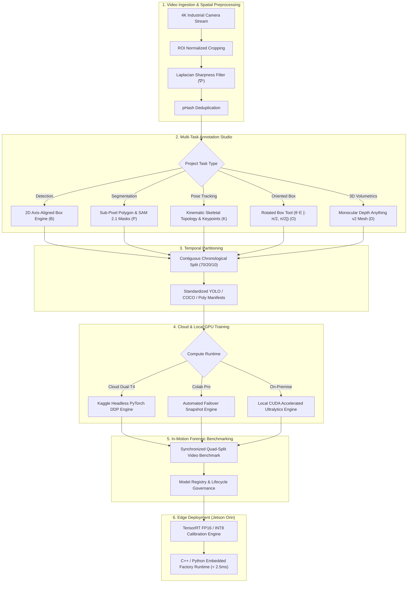
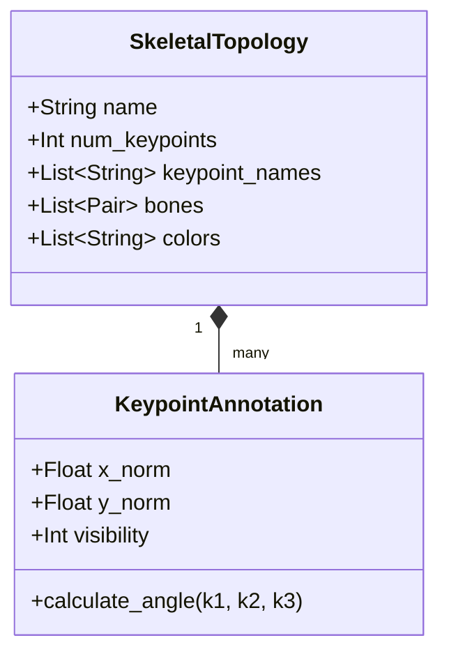
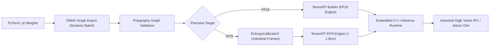

# VisionForge Studio: Enterprise Multi-Model Architecture Roadmap
## Advanced Instance Segmentation, Pose Estimation, Oriented Bounding Boxes (OBB) & 3D Volumetrics

**Document Version:** 2.4.0-PROD  
**Classification:** Enterprise Engineering Architecture & Strategic Specification  
**Target Platform:** VisionForge Studio Industrial AI/ML Platform  
**Target Hardware:** NVIDIA Jetson Orin AGX, Local Workstations (RTX 4090), Kaggle Dual-T4 & Google Colab Pro Cloud Clusters  

---

## 1. Executive Summary & Vision

VisionForge Studio is architected as an industrial-grade, end-to-end computer vision software suite that replaces fragmented tooling (CVAT, Roboflow, custom OpenCV scripts, disconnected training notebooks, TensorBoard). 

While 2D axis-aligned bounding box (BBox) detection solves basic inventory and packaging presence, **production-grade manufacturing, logistics, and robotic automation demand advanced spatial understanding**:
1. **Pixel-Exact Segmentation**: For precise surface defect area measurement ($\text{mm}^2$), irregular packaging tears, liquid spills, and multi-class seal integrity auditing.
2. **Kinematic Pose & Keypoint Tracking**: For robotic pick-and-place gripper alignment, orientation estimation, and plant operator safety/ergonomic compliance (ISO 13849 hazard intrusion).
3. **Oriented Bounding Boxes (OBB)**: For tightly packed, skewed, or rotated parcels on high-speed conveyors where axis-aligned boxes overlap and cause false Non-Maximum Suppression (NMS) dropouts.
4. **Monocular 3D Volumetrics & Transformers**: For single-camera cubic parcel volume calculation ($L \times W \times H$) without expensive LiDAR, and NMS-free real-time transformer detection (RT-DETR).

This document outlines the end-to-end architectural blueprint, mathematical foundations, data schemas, training pipeline enhancements, and edge deployment strategy for expanding VisionForge into a **Full-Spectrum Multi-Task AI Engine**.



---

## 2. Domain 1: Advanced Instance & Semantic Segmentation Engine

### 2.1 Problem Definition & Industrial Need
On industrial conveyor belts and sorting lines, defects (scratches, dents, puncture tears) and items (deformed polybags, irregular shrink-wrapped pallets) cannot be accurately represented by rectangular bounding boxes. Bounding boxes include excessive background pixels, degrading defect classification accuracy and preventing geometric area measurement.

### 2.2 Model Architecture Matrix
| Model Architecture | Parameter Size | Input Resolution | Val Mask mAP50-95 | Latency (Jetson Orin FP16) | Primary Target |
| :--- | :--- | :--- | :--- | :--- | :--- |
| **YOLOv8n-seg** | 3.4M | 640 × 640 | 30.5% | 1.8 ms | Real-time sorting (120+ FPS) |
| **YOLOv8s-seg** | 11.8M | 640 × 640 | 36.8% | 3.2 ms | Balanced defect detection |
| **YOLO11n-seg** | 2.9M | 640 × 640 | 32.1% | 1.5 ms | Ultra-low power edge devices |
| **YOLO11m-seg** | 22.4M | 640 × 640 | 41.5% | 5.8 ms | High-precision cosmetic inspection |
| **SAM 2.1 (Hiera-Tiny)** | 38.9M | 1024 × 1024 | Zero-Shot SOTA | 22.4 ms | Auto-labeling & zero-shot grounding |
| **FastSAM-s** | 11.1M | 1024 × 1024 | Zero-Shot SOTA | 6.4 ms | Real-time candidate proposal |

### 2.3 Mathematical Loss Formulation
The segmentation loss function combines bounding box regression, classification, and pixel-level mask segmentation:

$$\mathcal{L}_{\text{total}} = \lambda_{\text{box}} \mathcal{L}_{\text{CIoU}} + \lambda_{\text{dfl}} \mathcal{L}_{\text{DFL}} + \lambda_{\text{cls}} \mathcal{L}_{\text{BCE}} + \lambda_{\text{mask}} \mathcal{L}_{\text{mask}}$$

Where the mask segmentation loss $\mathcal{L}_{\text{mask}}$ uses Binary Cross-Entropy with Focal Loss weighting over the prototype mask coefficients:

$$\mathcal{L}_{\text{mask}} = -\frac{1}{M} \sum_{i=1}^{M} \left[ y_i \log(\hat{y}_i) + (1 - y_i) \log(1 - \hat{y}_i) \right]$$

### 2.4 Annotation Canvas Enhancements
1. **Vectorized Polygon Editing**:
   - Bezier curve spline smoothing for organic package contours.
   - Magnetic edge snapping using Sobel gradient vectors on the canvas.
   - Point insertion, deletion, and vertex dragging with sub-pixel floating-point coordinates.
2. **Douglas-Peucker Polygon Simplification**:
   - Reduces dense polygon vertices to essential geometric nodes within an $\epsilon = 0.002$ normalized tolerance, minimizing storage footprint and training overhead.
3. **Interactive Meta SAM 2.1 Integration**:
   - Positive/negative green/red click anchors.
   - Bounding box prompt refinement: draw a loose box, SAM 2 calculates the exact boundary polygon.
   - Keyframe optical flow propagation: propagate segmentations across 30–60 consecutive video frames.

### 2.5 Standardized Dataset Schema
In accordance with Ultralytics YOLO segmentation standard:
```text
# <class-index> <x1> <y1> <x2> <y2> <x3> <y3> ... <xn> <yn> (Normalized 0.0 - 1.0)
0 0.123450 0.234560 0.145670 0.289010 0.189012 0.354120 0.112340 0.321450
```

---

## 3. Domain 2: Kinematic Pose Estimation & Keypoint Tracking

### 3.1 Problem Definition & Industrial Need
Modern manufacturing plants require tracking human worker postures (ergonomics, hazard zone breaches) and robotic manipulators (end-effector orientation, gripper pick-and-place tracking). 

### 3.2 Skeletal Topology Engine
VisionForge will introduce a configurable **Skeletal Topology Builder**:
- **COCO 17-Keypoint Standard**: Human ergonomics, worker safety, PPE tracking.
- **Industrial Rigid-Body 8-Keypoint Standard**: 3D bounding box corners on conveyor packages for orientation and stacking alignment.
- **Robotic Manipulator 4-Keypoint Standard**: Base, elbow, wrist, and gripper tips for robotic verification.



### 3.3 Visibility Flag Specification
In accordance with the international standard:
- `v = 0`: Keypoint not in frame or completely unlabeled.
- `v = 1`: Keypoint labeled but occluded by packaging or machinery.
- `v = 2`: Keypoint clearly visible and labeled with sub-pixel precision.

### 3.4 Mathematical Loss Formulation
Pose estimation optimization is driven by **Object Keypoint Similarity (OKS)**:

$$\text{OKS} = \frac{\sum_{i} \exp\left( -d_i^2 / (2 s^2 \sigma_i^2) \right) \delta(v_i > 0)}{\sum_{i} \delta(v_i > 0)}$$

Where:
- $d_i$ is the Euclidean distance between predicted and ground-truth keypoint.
- $s$ is the scale factor (square root of the object bounding box area).
- $\sigma_i$ is the per-keypoint standard deviation constant (accounting for labeling ambiguity).

### 3.5 Industrial Use Cases
1. **Robotic End-Effector Orientation**: Determine conveyor item heading angle ($\theta_{\text{heading}}$) so robotic vacuum grippers match orientation before contact.
2. **Plant Safety Hazard Intrusion**: Continuously calculate the minimum Euclidean distance between operator wrist keypoints and active robotic pinch points (ISO 13849 safety distance violation alarms).

---

## 4. Domain 3: Oriented Bounding Boxes (OBB)

### 4.1 Problem Definition & Industrial Need
On high-speed conveyor belts and gantry sorting lines, items arrive at arbitrary skew angles ($\theta \in [-\pi/2, \pi/2]$). Standard axis-aligned bounding boxes (AABB) expand drastically when an item is tilted, causing substantial overlap between neighboring parcels. This overlap triggers false Non-Maximum Suppression (NMS), dropping valid items from production tracking.

```
Axis-Aligned BBox (Wasteful overlap):
┌────────────────────────┐
│     ╱────────────╲     │  <-- 60% empty background inside box!
│    ╱   PARCEL     ╲    │  <-- Causes overlapping NMS conflicts.
│   ╱                ╲   │
│   ╲                ╱   │
│    ╲──────────────╱    │
└────────────────────────┘

Oriented Bounding Box (Exact tight fit):
      ╱────────────────╲
     ╱      PARCEL      ╲
    ╱                    ╲
    ╲                    ╱
     ╲──────────────────╱
```

### 4.2 OBB Representation & Mathematical Models
- **YOLOv8-obb** and **YOLO11-obb**:
  - Representation: Centroid $(x_c, y_c)$, width $w$, height $h$, and rotation angle $\theta$.
  - Projection: Converted to 4 normalized vertices $(x_1, y_1), (x_2, y_2), (x_3, y_3), (x_4, y_4)$ for rendering and evaluation.
- **Loss Metric**: Probabilistic IoU (ProbIoU) and Gaussian Wasserstein Distance (GWD) to resolve angle boundary discontinuities ($-\pi/2 \leftrightarrow \pi/2$).

### 4.3 Standardized OBB Dataset Format
```text
# <class-index> <x1> <y1> <x2> <y2> <x3> <y3> <x4> <y4>
0 0.205 0.310 0.450 0.120 0.620 0.280 0.375 0.470
```

---

## 5. Domain 4: Monocular 3D Volumetrics & Foundation Models

### 5.1 Monocular Depth Anything v2 Integration
Standard warehouse dimensioning requires multi-thousand-dollar overhead LiDAR sensors. VisionForge will integrate **Depth Anything v2 (Small / Base)** to extract metric relative depth maps directly from standard 2D conveyor cameras:
- **Surface Elevation Extrusion**: Computes pixel-wise distance to camera lens.
- **Conveyor Plane Calibration**: Automatically fits a planar equation $Ax + By + Cz + D = 0$ to the conveyor belt surface.
- **Cubic Parcel Volume ($L \times W \times H$)**: Integrates the extruded height profile above the conveyor plane to estimate package cubic volume in cubic centimeters ($\text{cm}^3$) with $< 5\%$ volumetric error.

### 5.2 Real-Time Detection Transformers (RT-DETR)
For ultra-dense parcel streams where overlapping bounding boxes challenge heuristic NMS algorithms:
- **Architecture**: RT-DETR-L / RT-DETR-X with hybrid encoder and uncertainty-minimal query selection.
- **Advantage**: 100% NMS-free end-to-end inference, eliminating hyperparameter tuning for IoU thresholds.

---

## 6. End-to-End Edge Deployment Architecture (NVIDIA Jetson Orin AGX)

To achieve enterprise line-rate inference ($> 60\text{ FPS}$, latency $< 3.0\text{ ms}$), VisionForge provides automated TensorRT compilation pipelines:



### 6.1 Custom TensorRT Plugins
1. **YOLO-Seg Post-Processing Plugin**: Performs proto-mask matrix multiplication directly in GPU VRAM without host memory copies.
2. **YOLO-Pose Keypoint OKS Filter**: Decodes keypoint heatmaps on CUDA cores, returning compact coordinate structs directly to PLC fieldbuses via MQTT/OPC-UA.

---

## 7. Phased Implementation Roadmap & Milestones

```
Phase 1: Advanced Segmentation (YOLOv8/v11-seg + SAM 2.1)
├── Milestone 1.1: Database Schema Expansion (Polygon & Mask JSON)
├── Milestone 1.2: Canvas Polygon Tooling with Bezier & Magnetic Snapping
├── Milestone 1.3: Meta SAM 2.1 Keyframe Video Propagation
└── Milestone 1.4: Kaggle Dual-T4 Headless Segmentation Training & Loss Plots

Phase 2: Oriented Bounding Boxes (OBB)
├── Milestone 2.1: Rotated Box Canvas Tool (Angle Handle & 4-Vertex Math)
├── Milestone 2.2: OBB Format Export (8-point coordinates) & YOLO-OBB Runner
└── Milestone 2.3: In-Motion Benchmark with Rotated Jitter Auditing

Phase 3: Pose Estimation & Kinematics
├── Milestone 3.1: Skeletal Topology Builder & Keypoint Configurator
├── Milestone 3.2: Pose Canvas Tooling (Visibility Flags v=0,1,2 & Bone Links)
├── Milestone 3.3: YOLO-Pose Training on Cloud Dual-T4
└── Milestone 3.4: Robotic Gripper Alignment & Ergonomic Safety Distance Audits

Phase 4: 3D Volumetrics & NMS-Free Transformers
├── Milestone 4.1: Depth Anything v2 Monocular Plane Calibration
├── Milestone 4.2: Cubic Volume Calculation Engine (cm³)
└── Milestone 4.3: RT-DETR NMS-Free Transformer Integration
```

### 7.1 Detailed Phase Breakdown

#### Phase 1: Instance Segmentation (Weeks 1 – 3)
- **Database Schema**: Add `polygon` coordinates array `[[x, y], ...]` and `mask_rle` field to `annotations` table in `backend/app/models.py`.
- **Annotation Canvas**:
  - Implement Polygon Tool (`P`) with vertex creation, deletion, and dragging.
  - Implement Douglas-Peucker simplification algorithm.
  - Connect SAM 2.1 interactive point prompts (`/api/v1/annotations/sam-prompt`).
- **Training Runner**:
  - Add `yolov8n-seg.pt` and `yolo11n-seg.pt` base weight options in Training Center.
  - Output segmentation `data.yaml` with polygon label files.
  - Track `mask_loss` and `mAP50-95(M)` on Kaggle telemetry HUD.

#### Phase 2: Oriented Bounding Boxes (Weeks 4 – 5)
- **Database Schema**: Add `obb` annotation type with coordinates `[x1, y1, x2, y2, x3, y3, x4, y4]`.
- **Annotation Canvas**:
  - Implement Rotated Box Tool (`O`) with center-point dragging and angle adjustment handle ($\theta$).
- **Training Runner**:
  - Support `yolov8n-obb.pt` and `yolo11n-obb.pt`.
  - Render oriented bounding boxes with rotational angle indicators on the Quad-Split validation player.

#### Phase 3: Pose Estimation & Kinematic Keypoints (Weeks 6 – 8)
- **Database Schema**: Add `pose` annotation type with `keypoints: [{"id": 0, "name": "wrist", "x": 0.4, "y": 0.3, "v": 2}]`.
- **UI Configurator**:
  - Skeletal topology builder in Project Settings (define joint names and bone connections).
- **Training Runner**:
  - Support `yolov8n-pose.pt` and `yolo11n-pose.pt`.
  - Display OKS (Object Keypoint Similarity) metrics and skeleton overlays during validation.

#### Phase 4: 3D Volumetrics & Transformers (Weeks 9 – 11)
- **Depth Estimation**:
  - Integrate `Depth-Anything-V2-Small` ONNX runtime pipeline.
  - Automatic conveyor belt ground plane fitting.
  - Real-time parcel volume estimation ($L \times W \times H$) in cubic centimeters.
- **Transformer Detection**:
  - Add `rt-detr-l.pt` support for dense conveyor inspection with zero NMS post-processing.

---

## 8. Quality Assurance, Security & Enterprise Standards

1. **Deterministic Testing**: Every phase requires automated PyTest coverage for format conversions, IoU/OKS calculations, and API endpoints.
2. **Backward Compatibility**: Existing 2D detection datasets and models remain 100% operational; multi-task capabilities are configured per project.
3. **Auditability & Traceability**: All model training runs record full dependency hashes, dataset checksums, and training recipes in SQLite/PostgreSQL with immutable audit logs.
4. **Zero-Lockin Guarantee**: Export weights freely to ONNX, TensorRT, CoreML, OpenVINO, and PyTorch TorchScript formats at any time.

---

**Approved by:** VisionForge Industrial AI/ML Engineering Council  
**Repository:** [github.com/Sanchit711/Visionforge](https://github.com/Sanchit711/Visionforge)
